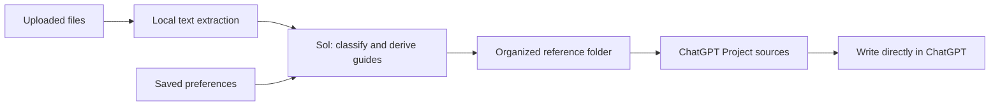

# Model settings

The library organizer uses **GPT-6.1 Sol / low** to classify documents and derive
style guides in one structured-output request. Settings were checked against the
Codex catalog and official documentation on October 20, 2026.

Sol is the default because a mixed library can require judgment about authorship,
audience, and differences between genres. Luna / high may be suitable for simpler
classification tasks. The best choice will depend on the samples and results.

Analysis uses up to 40 documents, with at most 16,000 characters from the beginning,
middle, and end of each long document. Full extracted text is retained locally and
included in the prepared ChatGPT reference files. Guides may miss traits absent
from the excerpts, so uncertain classifications should be reviewed.

Unchanged libraries skip repeat analysis. Requests time out after six minutes;
a failed attempt can be retried without uploading again, although it may still
count toward account usage. Exporting an existing analysis does not call a model.

To change the model, edit MODEL and EFFORT in writing.py after checking
`codex debug models`. Use a model that supports structured output in the installed
CLI. Partition does not silently switch providers.

Analysis runs in a temporary directory with shell, apps, plugins, browsing, memory
access, and subagents disabled. Samples are passed through stdin. Normal Codex
sign-in provides authentication.

Sources: [Models](https://learn.chatgpt.com/docs/models),
[model and reasoning settings](https://learn.chatgpt.com/docs/agent-configuration/subagents),
[CLI reference](https://learn.chatgpt.com/docs/cli-reference).
