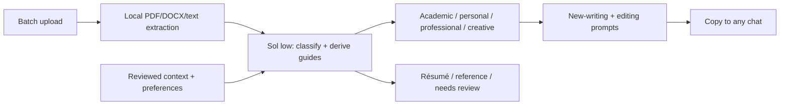

# Writing model map

Default: **GPT-6.1 Sol / low** for classification and guide synthesis in a single
structured-output request. Checked 2026-10-20. It handles ambiguous source types,
mixed genres, evidence-grounded style analysis and prompt synthesis together.

The application does not run a costly agent hierarchy for each document or train
weights. One request sees up to 40 documents with at most 16,000 characters of
head/middle/tail excerpts per document. Full extracted text and originals stay local.
Long or unusually varied documents may need more samples or human correction.
Unchanged library fingerprints skip repeated analysis. This reduces unnecessary
requests, not a hard spending cap. Timeout is six minutes; failures retain originals
and previous guide versions, and a retry may incur additional model usage.

Luna / high is a possible faster option for clear classification, but the default
uses Sol to also synthesize nuanced guides. There is no benchmark claiming an
absolute best writing model. Change MODEL and EFFORT in writing.py together after
checking `codex debug models`; use a model supporting structured output in your CLI.
No fallback silently sends your samples to a different provider.

The model runs in an empty temporary directory with shell, apps, plugins, browsing,
memories and subagents disabled; samples are stdin data. Account sign-in still
uses Codex's standard authentication. Generated text is rendered as text, never HTML.

Sources: [official model guidance](https://learn.chatgpt.com/docs/models),
[Codex model settings](https://learn.chatgpt.com/docs/agent-configuration/subagents),
[CLI reference](https://learn.chatgpt.com/docs/cli-reference).
